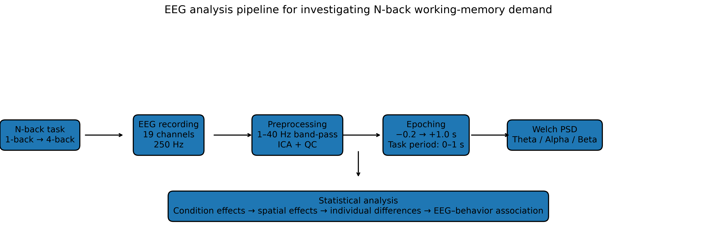
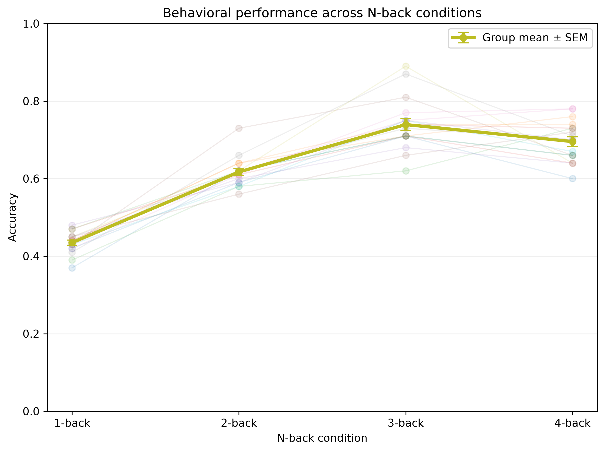
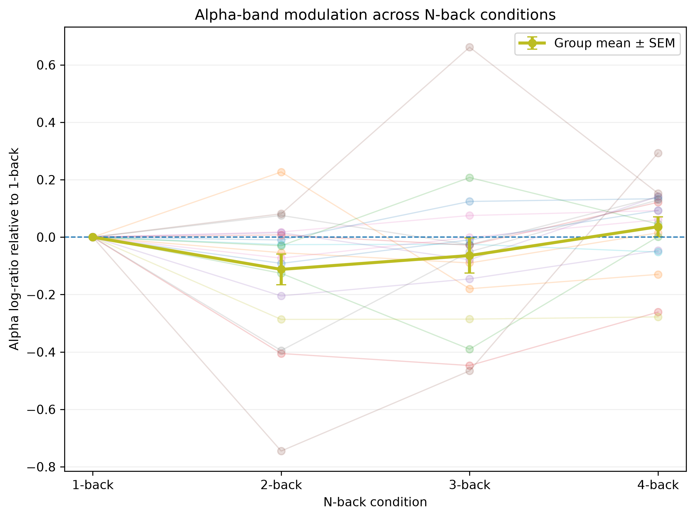
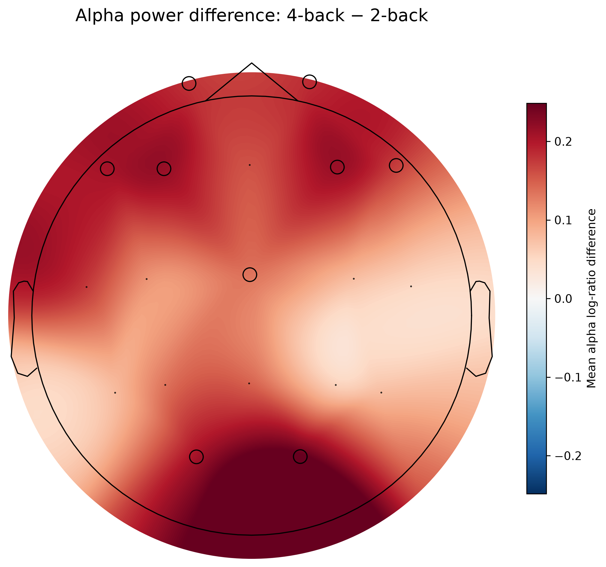
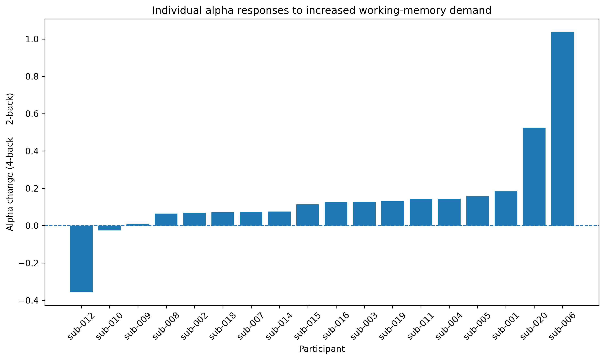
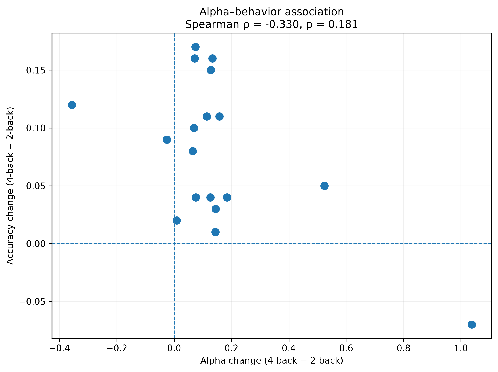

# EEG Signatures of Increasing Working-Memory Demand

An EEG analysis investigating how oscillatory activity changes across increasing N-back working-memory demands, with a focus on theta, alpha, and beta power, individual differences, and EEG–behavior relationships.

---

## Research Question

> **How do EEG oscillatory patterns change as working-memory demand increases from 1-back to 4-back, and how consistent are these changes across individuals?**

Rather than treating the task as a classification problem, this project investigates EEG dynamics associated with different levels of working-memory demand.

---

## Dataset

This project uses the **Cognitive Workload 5-level n-back** dataset from OpenNeuro.

| Property | Details |
|---|---|
| Dataset | ds007169 |
| Modality | EEG |
| Participants analyzed | 18 |
| EEG channels | 19 |
| Sampling frequency | 250 Hz |
| Conditions | 1-back, 2-back, 3-back, 4-back |

The dataset was accessed using DataLad and analyzed locally.

**Dataset:** https://openneuro.org/datasets/ds007169

---

## Analysis Pipeline

```text
Raw EEG
   ↓
Scaling verification
   ↓
1–40 Hz band-pass filtering
   ↓
ICA-based ocular artifact correction
   ↓
Event extraction
   ↓
Epoching (-0.2 to +1.0 s)
   ↓
Epoch-level artifact screening
   ↓
Task period (0–1 s)
   ↓
Welch PSD
   ↓
Theta / Alpha / Beta band power
   ↓
Log-ratio relative to 1-back
   ↓
Statistical analysis
   ↓
Spatial analysis
   ↓
Individual-difference analysis
   ↓
EEG–behavior analysis
```

---

# Preprocessing

## EEG Scaling

The original BrainVision recordings produced unusually large numerical values when initially loaded with MNE.

The BrainVision header indicated EEG channels in microvolts with a nominal channel resolution of 0.1 µV.

A working scaling correction was applied during preprocessing to obtain physiologically plausible EEG amplitudes.

The exact physical calibration of the original binary representation was not independently established from authoritative dataset documentation and is therefore documented as a limitation.

## Filtering

The continuous EEG was band-pass filtered between **1–40 Hz**.

This range was chosen to retain the theta, alpha, and beta frequency bands while reducing slow drift and higher-frequency activity outside the primary analysis range.

Filtering was treated as preprocessing rather than artifact removal.

## Independent Component Analysis

Independent Component Analysis (ICA) was used to identify components likely to contain ocular artifacts.

### ICA configuration

- **Method:** FastICA
- **Components:** 19
- **Random state:** 42
- **Decimation:** Applied during ICA fitting

The dataset did not provide a dedicated EOG channel for the analysis. Therefore, frontal EEG channels **Fp1 and Fp2** were used as supporting indicators when evaluating candidate ocular components.

Candidate components were evaluated using:

- Correlation with Fp1/Fp2
- Component time course
- Frontal topography
- Temporal correspondence with frontal activity

Component polarity was treated as arbitrary, so absolute correlation was considered.

## Epoching

Experimental N-back trials were extracted from the event files.

Tutorial trials were excluded.

Each experimental trial was epoched from:

**−0.2 s to +1.0 s**

relative to event onset.

The baseline interval was −0.2 to 0 s.

The primary spectral analysis used the **0–1 s task period**.

The short 0.2-second baseline was not used for primary PSD normalization because it provides limited frequency resolution for spectral estimation.

## Artifact Quality Control

Epoch-level artifact screening was performed using peak-to-peak (PTP) amplitude.

For every epoch:

- Maximum channel PTP was calculated
- Median channel PTP was calculated
- Participant-specific 95th-percentile thresholds were used
- Candidate high-amplitude epochs were identified
- Representative candidate epochs were visually inspected

## Final Epoch Dataset

There were initially **7,200 experimental epochs** across 18 participants.

After artifact rejection:

| Measure | Value |
|---|---:|
| Initial epochs | 7,200 |
| Retained epochs | 7,177 |
| Rejected epochs | 23 |
| Rejection rate | ~0.32% |

---

# Spectral Analysis

Power spectral density (PSD) was estimated using **Welch's method**.

### PSD parameters

| Parameter | Value |
|---|---:|
| Sampling frequency | 250 Hz |
| Window length | 0.5 s |
| Window samples | 125 |
| Overlap | 62 samples |
| Frequency range | 1–40 Hz |

## Frequency Bands

| Band | Frequency range |
|---|---:|
| Theta | 4–8 Hz |
| Alpha | 8–13 Hz |
| Beta | 13–30 Hz |

These bands were used as descriptive frequency ranges rather than one-to-one indicators of specific cognitive processes.

## Relative Power Representation

Condition power was represented using a log-ratio relative to the 1-back condition:

\[
\log\left(\frac{\text{condition power}}{\text{1-back power}}\right)
\]

Interpretation:

- **0** → no change relative to 1-back
- **Positive** → increase relative to 1-back
- **Negative** → decrease relative to 1-back

---

# Results

## Behavioral Performance

| Condition | Mean accuracy |
|---|---:|
| 1-back | 43.5% |
| 2-back | 61.7% |
| 3-back | 73.9% |
| 4-back | 69.6% |

### Friedman test

- **Statistic:** 48.1844
- **p < 0.001**
- **Kendall's W:** 0.8923

Accuracy did not decrease monotonically with N-back level. It increased from 1-back through 3-back and then decreased at 4-back.

> **Note:** Behavioral results are interpreted cautiously because a post-hoc audit raised concerns about the validity of the recorded `Matched` labels used to derive behavioral accuracy.

---

## Theta

| Condition | Mean log-ratio |
|---|---:|
| 1-back | 0.000 |
| 2-back | −0.0395 |
| 3-back | −0.0054 |
| 4-back | +0.0107 |

### Repeated-measures ANOVA

**F(3,51) = 0.3235, p = 0.8083**

### Friedman test

**χ² = 0.6000, p = 0.8964**

**Kendall's W = 0.0111**

There was no evidence of a significant overall theta condition effect.

---

## Alpha

| Condition | Mean log-ratio |
|---|---:|
| 1-back | 0.000 |
| 2-back | −0.1124 |
| 3-back | −0.0642 |
| 4-back | +0.0362 |

### Repeated-measures ANOVA

**F(3,51) = 2.9044, p = 0.0436**

### Friedman test

**χ² = 17.6667, p = 0.000515**

**Kendall's W = 0.3272**

The alpha pattern was not simply monotonic with workload.

### Alpha: 2-back vs 4-back

After Bonferroni correction:

| Statistic | Value |
|---|---:|
| Wilcoxon W | 18 |
| Raw p | 0.001930 |
| Bonferroni-adjusted p | 0.011581 |
| Rank-biserial correlation | 0.7895 |
| Mean paired difference | +0.1486 |
| Median paired difference | +0.1200 |

---

## Beta

| Condition | Mean log-ratio |
|---|---:|
| 1-back | 0.000 |
| 2-back | −0.0454 |
| 3-back | +0.0188 |
| 4-back | +0.0513 |

### Repeated-measures ANOVA

**F(3,51) = 0.6252, p = 0.6020**

### Friedman test

**χ² = 8.6667, p = 0.0341**

**Kendall's W = 0.1605**

The beta effect was not robust after correction for multiple comparisons.

---

# Spatial Alpha Analysis

The 2-back versus 4-back alpha comparison was evaluated across the 19 EEG channels using FDR correction.

### Electrodes surviving FDR correction

- F3
- O2
- F4
- O1
- Cz
- F8
- Fp1
- F7
- Fp2

All nine showed a positive 4-back minus 2-back difference.

The scalp topography is an electrode-level visualization and should not be interpreted as precise cortical localization.

---

# Individual Differences

The alpha response was calculated as:

\[
\text{Alpha response}
=
\text{4-back alpha log-ratio}
-
\text{2-back alpha log-ratio}
\]

- **16/18 participants** showed a positive response
- **2/18 participants** showed a negative response

The magnitude of the response varied considerably between participants.

## Leave-One-Out Sensitivity

The alpha 2-back versus 4-back result remained statistically significant in **18/18 leave-one-out analyses**.

The p-value range was approximately:

**0.000046–0.003845**

---

# EEG–Behavior Relationship

An exploratory participant-level analysis compared:

### Alpha response

\[
\text{4-back alpha log-ratio}
-
\text{2-back alpha log-ratio}
\]

### Behavioral response

\[
\text{4-back accuracy}
-
\text{2-back accuracy}
\]

### Spearman correlation

| Statistic | Value |
|---|---:|
| ρ | −0.330 |
| p | 0.181 |
| n | 18 |

The association was not statistically significant.

A leave-one-out analysis also found no participant whose removal produced a statistically significant correlation.

---

# Main Findings

1. Behavioral performance differed strongly across N-back conditions.
2. Alpha-band activity showed the clearest condition-related modulation among the three analyzed frequency bands.
3. The alpha 2-back versus 4-back difference showed a distributed electrode-level pattern and substantial individual variability.
4. The exploratory EEG–behavior association was not statistically significant.

The results support describing alpha-band activity as an EEG correlate **associated with task condition in this dataset**.

They do not establish alpha activity as a mechanism or cause of working-memory performance.

---

# Figures

## Analysis Pipeline



## Behavioral Performance



## Alpha Workload Response



## Alpha Spatial Distribution



*Black markers indicate electrodes surviving FDR correction.*

## Individual Alpha Responses



## EEG–Behavior Relationship



---

# Repository Structure

```text
nback-eeg-working-memory-analysis/
│
├── README.md
├── .gitignore
│
├── src/
│   ├── preprocessing/
│   ├── spectral_analysis/
│   ├── statistics/
│   └── visualization/
│
├── results/
│   ├── figures/
│   └── tables/
│
├── report/
│   └── NBack_EEG_Analysis_Report.pdf
│
└── docs/
    └── analysis_log.md
```

---

# Reproducibility

The repository contains:

- Analysis code
- Derived result tables
- Final figures
- Documentation
- The final report

Raw EEG recordings and cleaned EEG `.fif` files are **not included**.

To reproduce the analysis:

1. Obtain the dataset directly from OpenNeuro.
2. Set up the required Python environment.
3. Run the preprocessing scripts.
4. Run the spectral analysis scripts.
5. Run the statistical analysis scripts.
6. Generate the final figures.

---

# Limitations

- The analysis contains 18 participants.
- Scalp EEG has limited spatial resolution.
- Electrode-level topographies do not provide precise cortical localization.
- The EEG scaling required a working correction whose physical calibration was not independently established from authoritative dataset documentation.
- The preprocessing pipeline did not provide a complete automated investigation of every possible ECG, EMG, electrode, and movement artifact.
- Theta, alpha, and beta are broad frequency ranges and should not be treated as one-to-one indicators of specific cognitive processes.
- The available event data did not provide a usable reaction-time measure.
- Several exploratory analyses were performed, so corrected statistical tests were emphasized.
- The analyses do not establish causal relationships between EEG activity and behavior.

---

# Conclusion

This project investigated EEG oscillatory activity across increasing N-back working-memory conditions using an end-to-end computational neuroscience workflow.

The analysis identified condition-related modulation in the alpha band, particularly in the 2-back versus 4-back comparison. This effect showed a distributed electrode-level pattern and substantial individual variability.

The exploratory EEG–behavior analysis did not show a statistically significant association between alpha change and behavioral change.

Overall, the project demonstrates a complete workflow from EEG preprocessing and artifact handling through spectral analysis, statistical testing, spatial analysis, individual-difference analysis, and behavioral integration.

---

# Dataset Citation

Booth, L., & Barras, M. *Cognitive Workload 5-level n-back*. OpenNeuro, ds007169.

**Dataset:** https://openneuro.org/datasets/ds007169

Please cite the original dataset and follow the dataset's licensing and attribution requirements when using the data.
